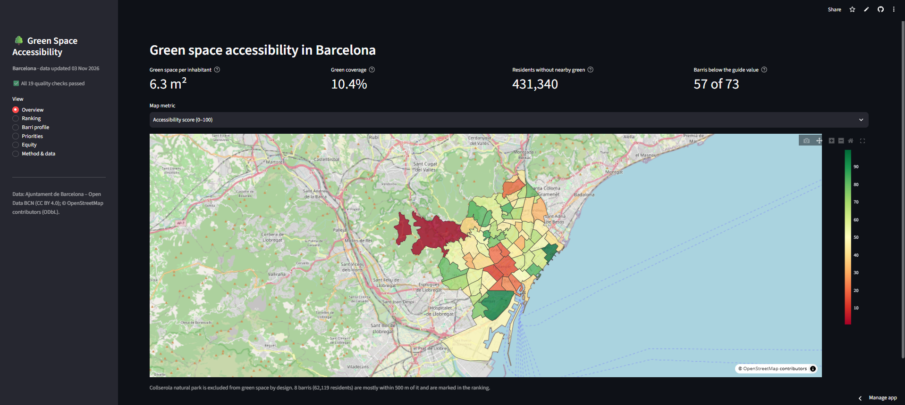
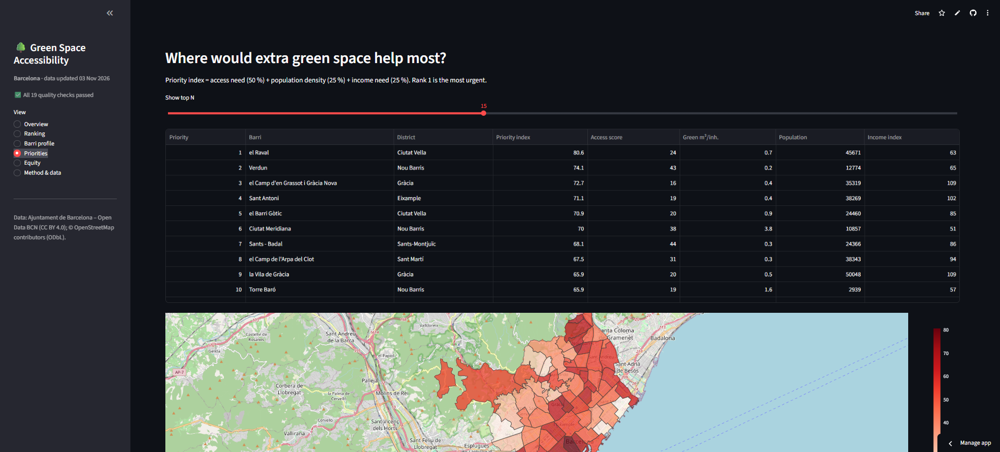
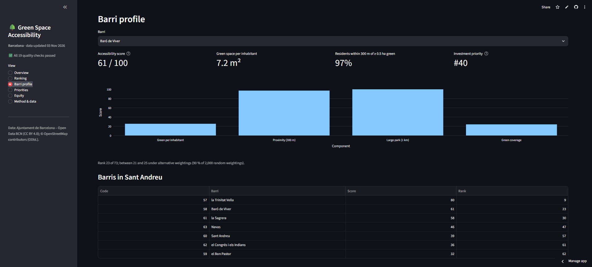
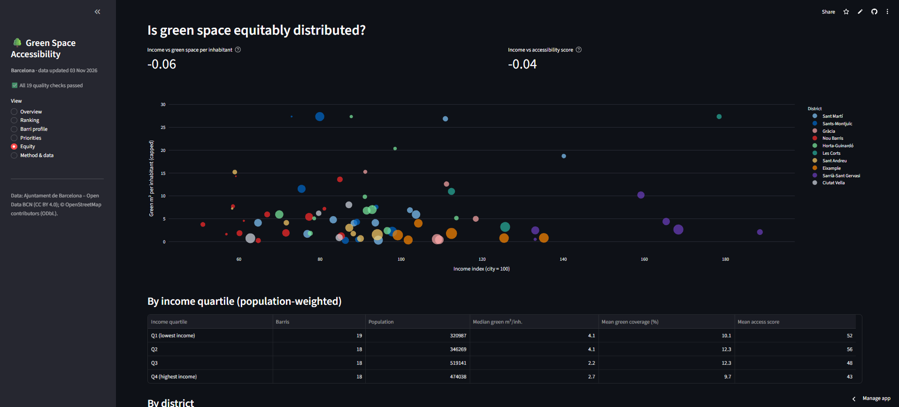
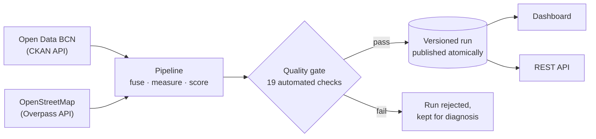

# Green Space Accessibility — Barcelona

**A reproducible, API-driven data product that measures how well each of Barcelona's 73 barris residents can actually reach green space and shows where new green space would help the most people.**

[](https://barca-green-area-accessibility.streamlit.app)
[](#getting-started)
[](LICENSE)
[](#data-sources--attribution)

**Try it: [barca-green-area-accessibility.streamlit.app](https://barca-green-area-accessibility.streamlit.app)**

<p align="center">
  
</p>

---

## Contents
[Why this project](#why-this-project) · [Key results](#key-results) · [How it works](#how-it-works) · [Engineering highlights](#engineering-highlights) · [Architecture & deployment](#architecture--deployment) · [Tech stack](#tech-stack) · [Getting started](#getting-started) · [REST API](#rest-api) · [Data-quality gate](#data-quality-gate) · [Project structure](#project-structure) · [Testing](#testing) · [Limitations & roadmap](#limitations--roadmap) · [Data sources & attribution](#data-sources--attribution) · [License](#license)

---

## Why this project

Barcelona is one of Europe's densest cities, and "how much green space does it have?" is a question with many wrong answers. A city-wide average hides the fact that a barri can contain a huge park and still leave most of its residents far from any green space. This project answers a more useful question:

> **Can the people who live in each barri reach a good green space on foot — and who is being left behind?**

It turns open data into a transparent, repeatable **Green Accessibility Score (0–100)** for every barri, a **ranking**, an **investment-priority index**, and an **equity view** that overlays household income — all refreshed automatically from public APIs, with no manual data wrangling.

## Key results

*Figures from the November 2026 run; the live dashboard refreshes monthly.*

| Indicator | Value |
|---|---|
| Green space per inhabitant | **6.3 m²** (guide value: 9 m²) |
| Green coverage of the city | **10.4 %** |
| Barris below the 9 m² guide value | **57 of 73** |
| Residents with no ≥ 0.5 ha green space within 300 m *(estimate)* | **≈ 431,000** |

| Best-accessibility barris | Score | | Lowest-accessibility barris | Score |
|---|---|---|---|---|
| Diagonal Mar i el Front Marítim del Poblenou | 99 | | Vallvidrera, el Tibidabo i les Planes ¹ | 1 |
| el Poble-sec | 96 | | l'Antiga Esquerra de l'Eixample | 11 |
| el Coll | 87 | | la Dreta de l'Eixample | 14 |
| la Guineueta | 85 | | el Camp d'en Grassot i Gràcia Nova | 16 |
| la Vila Olímpica del Poblenou | 83 | | Sant Antoni | 19 |

¹ *Collserola natural park is deliberately **not** counted as green space, so barris on its edge score low. They are flagged in the dashboard ("score excludes adjacent natural park") rather than silently re-ranked.*

**Highest investment priority** (low access × high density × lower income): el Raval, Verdun, el Camp d'en Grassot i Gràcia Nova, Sant Antoni, el Barri Gòtic.

**Equity:** across barris there is essentially no linear relationship between income and green space per inhabitant (rank correlation ≈ −0.06). By income quartile, median green space per inhabitant is 4.1 m² (lowest-income) and 4.1 m² (Q2) against 2.2 m² and 2.7 m² for the upper two quartiles. *(Descriptive statistics only — they show where green space is scarce, not why.)*

<p align="center">
  
  
  
</p>

## How it works



**1. Collect — everything via API, nothing downloaded by hand.**
Barri boundaries, municipal population (Padró), household income per capita and the city's official green-space polygons come from the **Open Data BCN CKAN API**. Parks, gardens, rail stations, building footprints and the Collserola natural-park boundary come from the **OpenStreetMap Overpass API**.

**2. Build one trustworthy green-space layer.**
OSM polygons and the city's official polygons are merged and **dissolved** (no double counting), the Collserola natural park is subtracted, and the result is cross-checked against the city's park register.

**3. Measure access, not just supply.**
Residents are located using **66,000+ building footprints** (weighted by floor area) instead of assuming people live evenly across a barri. For every barri the pipeline measures:

| Component | What it measures | Weight |
|---|---|---|
| Green space per inhabitant | m² of green per resident (winsorised 5–95 %) | 30 % |
| Proximity | % of residents within **300 m** of a green space ≥ **0.5 ha** | 35 % |
| Large-park access | % of residents within **1 km** of a green space ≥ **5 ha** | 15 % |
| Coverage | % of the barri's area that is green | 20 % |

→ weighted into the **Green Accessibility Score** and a rank (1 = best).

**4. Prioritise.** The **priority index** combines access need (50 %), population density (25 %) and income need (25 %) to point at where an extra hectare would help the most people.

**5. Test the result, not just the code.** Every rank comes with a **stability range** across 2,000 random re-weightings of the score components, so users can see which positions are robust and which depend on the weights.

## Engineering highlights

What makes this more than a notebook:

- **Multi-source data fusion with provenance.** Five Open Data BCN datasets and four OpenStreetMap queries are combined; every run records exactly which resource, reference year and parameters produced each number (`metadata.json`).
- **An automated data-quality gate that can reject a run.** 19 checks (unit counts, population totals, plausible green coverage per barri, agreement with the city park register, resident-sampling coverage, ranking drift vs. the previous run…). A failed run is kept for diagnosis and never served. *This gate exists because a real data error — a non-green dataset that made the historic centre look 100 % green — slipped through an earlier version.*
- **Resilient by design.** Retries with exponential back-off and rotation across Overpass servers; API responses cached per query (keyed on the query parameters, with a max age); a clear failure instead of silently degrading to lower-quality sampling.
- **Versioned, atomic publishing.** Each run is an immutable folder; a pointer file flips only after validation, so readers never see half-written data; one-line rollback.
- **Reproducible and config-driven.** One validated YAML file defines sources, thresholds and weights; unknown keys are rejected; adding another city means writing a small data adapter, not touching the scoring engine.
- **Sensitivity analysis built in.** Rank-stability bands (Monte-Carlo over weights) instead of pretending a ranking is exact.
- **Equity-aware outputs.** Income overlay, bivariate map, income-quartile statistics.
- **70+ automated tests**, including geospatial logic on synthetic geometries (green-layer merging, exclusion zones, proximity shares) and API contract tests.
- **Zero-cost deployment** (see below) *and* a self-hosted Docker option.

## Architecture & deployment

```
 GitHub Actions (monthly)  ──►  greenspace run  ──►  greenspace publish  ──►  published/ snapshot (~1 MB, committed)
                                                                                      │
 Visitors  ──►  Streamlit Community Cloud  ◄── redeploys on every change, reads the snapshot directly
```

| Mode | Stack | Cost | Docs |
|---|---|---|---|
| **Serverless (live demo)** | GitHub Actions refreshes data monthly → snapshot committed to the repo → Streamlit Community Cloud serves the dashboard | **Free, no server, no card** | [`docs/FREE_DEPLOYMENT.md`](docs/FREE_DEPLOYMENT.md) |
| **Self-hosted** | Docker Compose: Caddy (automatic HTTPS) → dashboard + read-only FastAPI, with a scheduler container refreshing the data | One small VM | [`docs/DEPLOYMENT.md`](docs/DEPLOYMENT.md) |

The Docker option is provided and documented; the live demo uses the serverless mode.

## Tech stack

| Area | Tools |
|---|---|
| Geospatial & data | GeoPandas, Shapely, pyogrio, pandas, NumPy, OSMnx (Overpass), CKAN API |
| Scoring & stats | winsorised min-max scaling, weighted composites, Dirichlet Monte-Carlo rank stability |
| Backend | Python 3.10+, FastAPI, Uvicorn, typed dataclass configuration (YAML) |
| Frontend | Streamlit, Plotly |
| DevOps | pytest, Ruff, GitHub Actions, Docker (multi-stage), Docker Compose, Caddy |

## Getting started

### Run the dashboard on your machine (no data download needed)
```bash
git clone https://github.com/OceeDiTT/green_area_accessibility.git
cd green_area_accessibility
pip install -r requirements.txt
streamlit run src/greenspace/dashboard/app.py          # reads the committed ./published snapshot
```

### Run the full pipeline (fetches live data, ~10 min the first time)
The geospatial stack installs most reliably from conda-forge:
```bash
conda create -n greenspace -c conda-forge python=3.12 geopandas osmnx pyogrio pytest httpx pyyaml fastapi uvicorn streamlit plotly
conda activate greenspace
pip install -e . --no-deps

greenspace check-config          # validate configs/barcelona.yaml
greenspace run                   # fetch → fuse → score → quality gate → publish a versioned run
greenspace status                # what is live
greenspace publish               # export a small public snapshot to ./published
greenspace serve                 # REST API on :8000   (interactive docs at /docs)
```
Other commands: `greenspace schedule` (refresh when data is older than N days), `greenspace inspect --unit "<barri>"` and `greenspace explore-official` (data diagnostics).

### Configuration
Everything tunable lives in [`configs/barcelona.yaml`](configs/barcelona.yaml): data sources, which official layers to use and how to filter them, the excluded natural park, distance/size standards, score weights, validation thresholds.

## REST API

Read-only; served by `greenspace serve` or the Docker stack.

| Endpoint | Purpose |
|---|---|
| `GET /v1/barris` | list / filter (`district`, `tier`, `min_score`, `low_income`, `near_natural_park`, `q`) / sort / paginate |
| `GET /v1/barris/{code}` | one barri with all metrics and its district peers |
| `GET /v1/ranking?by=access\|priority` | best / worst lists |
| `GET /v1/districts`, `/v1/stats` | district and city-wide indicators, equity by income quartile |
| `GET /v1/geojson` | barri polygons (WGS84) with metrics as properties |
| `GET /v1/meta`, `/v1/quality` | live run, sources, parameters, attribution, quality-check results |
| `GET /health`, `/ready` | liveness / readiness (includes `data_age_days` for monitoring) |

## Data-quality gate

A run is published only if **no check fails**. A selection:

| Severity | Examples |
|---|---|
| **Reject the run** | not exactly 73 units · duplicate codes · missing population · implausible city population or green coverage · **any barri above 90 % green** · invalid scores · excluded natural-park boundary not found |
| **Warn** | population and income reference years more than 2 years apart · < 80 % agreement with the city park register · any barri above 70 % green · barris without building footprints · ranking drift vs. the previous run |

## Project structure

```
configs/             city configuration (YAML)
src/greenspace/
  pipeline.py        orchestration: ingest → green layer → metrics → score → validate → publish
  sources/           Open Data BCN (CKAN) and OpenStreetMap (Overpass) adapters
  green.py           hybrid green-space layer, exclusion zone, register cross-check
  metrics.py         per-barri supply and proximity metrics
  scoring.py         accessibility score, priority index, rank stability (pure functions)
  validate.py        data-quality gate
  store.py           versioned, atomic run storage        publish.py   public snapshot export
  api/               FastAPI app + data layer             dashboard/   Streamlit app + helpers
  cli.py             `greenspace` command line            diagnose.py  data diagnostics
tests/               unit, geospatial and API tests
deploy/              Docker Compose + Caddy (self-hosted)
.github/workflows/   CI and the monthly data refresh
docs/                deployment guides, decision log, runbook
notebooks/           exploratory prototype
published/           latest public data snapshot (used by the live dashboard)
```

## Testing
```bash
pip install -e ".[pipeline,api,dashboard,dev]"
pytest -q
```
Covers configuration validation, scoring and rank stability, the quality gate, run storage and rollback, the scheduler, retry/back-off, resource selection on the open-data portal, green-layer merging and exclusion on synthetic geometries, proximity shares, the API and the dashboard's data logic.

## Limitations & roadmap

**Known limitations** (also stated in the dashboard)
- Distances are straight-line, not walking routes; green-space *quality* (tree canopy, amenities, safety) is not assessed.
- Income is a barri average, so low-income residents of wealthier barris are invisible.
- The city's official park layer dates from 2019; OpenStreetMap supplies recency (the dashboard reports how much each source contributes).
- Collserola is excluded by design; barris on its edge are flagged but not re-scored.

**Roadmap**
- Walking-network (isochrone) distances · tree-canopy / NDVI quality layer · finer units (census sections or a hex grid)
- Second city via a new source adapter · what-if scenarios ("add 1 ha here — how does the score change?")

## Data sources & attribution

- **Ajuntament de Barcelona — [Open Data BCN](https://opendata-ajuntament.barcelona.cat/)** (CC BY 4.0): barri boundaries, population, household income, public green-space polygons, park register.
- **© [OpenStreetMap](https://www.openstreetmap.org/copyright) contributors** (ODbL): parks and gardens, stations, building footprints, natural-park boundary, basemap.

Results are modelled estimates intended for planning discussion, not official statistics.

## License

Code: [MIT](LICENSE). The data keep their own licences (above); the MIT licence covers the code only.

## Author

**Christian Oluoma** — geospatial data science & engineering · [LinkedIn](www.linkedin.com/in/oluomachristian) · [Medium](https://medium.com/@oluomachristiandigitrad)
